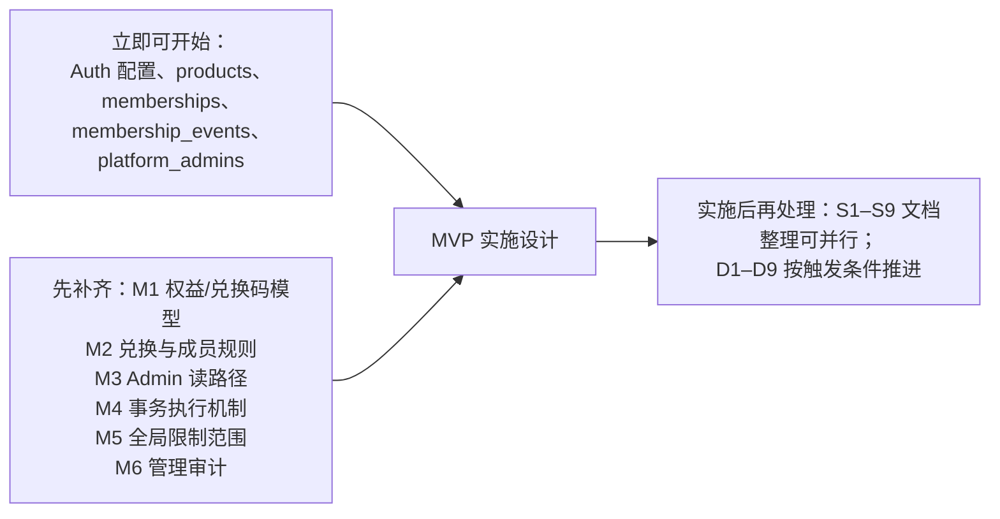

# AisenCore 架构审查报告

> 审查范围：`docs/spec/requirements.md`、`docs/architecture/` 下全部 17 份文档（含 `applications/admin-console.md`），并参照 `docs/README.md`、`AGENTS.md`、`docs/development/` 索引。
> 审查性质：只读审查。所有设计均按“**已确定的逻辑架构，尚未实施**”对待，不把候选设计当作已实现。本报告不修改项目内任何文件。

---

## 0. 结论速览

| 维度 | 评价 |
| --- | --- |
| 边界与原则 | **优秀**。身份 / 产品 / 成员 / 权益 / 业务资源五个维度彻底分离，“退出 ≠ 注销 ≠ 删数据 ≠ 取消续费”贯穿始终，不预建 SSO、RBAC、Redis、事件溯源，符合“轻量公共底座”定位。 |
| 成员领域 | **可直接进入实施设计**。三态模型、`pre_suspend_status`、唯一约束、同事务审计、并发语义都已闭环。 |
| 权益 / 兑换码领域 | **明显欠设计**。需求里优先级第 1 的“兑换码 → 产品权益 → 准入判定”这条链路没有逻辑实体、没有约束、没有接口契约。 |
| Admin 前端 | 方向正确（复用 Resource / Provider，敏感操作由服务端复核），但**读路径与 RLS 设计互相矛盾**，导致 `ra-supabase` / Data Provider 无法落地。 |
| 文档组织 | 五层分类合理，但**重复严重**（同一规则出现 4–6 次）、少量归类混杂、残留失效链接。设计权重失衡：成员约 6 篇反复论述，权益只有原则。 |
| 是否进入 MVP 实施设计 | **有条件进入**：身份/成员/Admin 骨架可以直接开始；先补齐 M1–M6 再做权益与兑换码实施设计（见第 5 节）。 |

---

## 1. 必须修复（按严重程度排序）

### M1【阻碍 MVP】产品权益、套餐与兑换码缺少逻辑数据模型和接口契约

- **涉及文件**：[billing-and-entitlements.md](file:///e:/Projects/Aisencore/docs/architecture/domains/billing-and-entitlements.md#L29-L33)、[identity-and-product-model.md](file:///e:/Projects/Aisencore/docs/architecture/domains/identity-and-product-model.md#L28)（“归权益专项”，但专项里没有）、[database-constraints-and-audit.md](file:///e:/Projects/Aisencore/docs/architecture/database/database-constraints-and-audit.md)（只覆盖 products / memberships / events）、[product-data-and-files.md](file:///e:/Projects/Aisencore/docs/architecture/database/product-data-and-files.md#L10)（“计费数据库位置未定”）、[public-api-and-saas-integration.md](file:///e:/Projects/Aisencore/docs/architecture/backend/public-api-and-saas-integration.md#L82-L95)。
- **问题**：
  1. 没有“套餐/权益方案”“用户授权记录（grant）”“兑换码”“兑换记录”任何一个逻辑实体，也没有唯一键、幂等键与事务不变量。
  2. `EvaluateProductAccess(product, capability)` 依赖“capability → 套餐功能/额度”的映射，但 capability 从何而来、谁维护、怎样从多条授权算出“当前有效权益”（叠加？取最长？永久与周期并存？）都没有定义。
  3. 兑换码的安全要求停留在“防重复/并发超量”的原则，缺少**防暴力枚举**（码熵、失败限流）和**存储方式**（明文还是哈希）这两项最基础的安全决定。
  4. “计费数据位置未定”被泛化到兑换码上；但兑换码核销与授权写入必须同一事务，实际上已经只能放在公共 PostgreSQL。
- **影响**：MVP 最优先功能（Admin 发码 → 用户兑换 → 产品判 Pro）无法做实施设计；Admin 的“产品权益”“自有兑换码”两个页面没有数据可以对接；各 SaaS 无法对接权益查询。
- **最小修改建议**：在 `domains/billing-and-entitlements.md` 补一节“MVP 权益逻辑模型”，在 `database/` 补对应约束（可并入 `database-constraints-and-audit.md` 或新增一篇），只定义以下最少内容：

  | 逻辑实体 | 最少字段 / 约束 |
  | --- | --- |
  | `plans` | `product_id`、`plan_key`（产品内 UNIQUE）、`features`（功能开关集合）、`limits`（额度数值），可选 `default_duration` |
  | `entitlement_grants` | `user_id`、`product_id`、`plan_id`、`source_type`（`redeem_code` / `admin` / 将来 `afdian`…）、`source_ref`、`starts_at`、`ends_at`（NULL = 永久非周期授权）、`revoked_at`；`UNIQUE(source_type, source_ref)` 作为幂等键 |
  | `redemption_codes` | `code_hash`（UNIQUE，仅创建时展示一次明文）、`product_id`、`plan_id`、`grant_duration`、`max_redemptions`、`redeemed_count`、`expires_at`、`revoked_at` |
  | `redemptions` | `code_id`、`user_id`、`grant_id`、`created_at`；`UNIQUE(code_id, user_id)` |

  再明确三条规则：①“当前有效权益 = 未撤销且 `now()` 处于有效期内的授权并集”，**直接查询，不是事件回放**；②capability 就是 `plans.features` 里的键，由管理员按产品维护，不建平台级能力注册中心；③兑换在一个事务中完成“锁定码 → 校验 → `redeemed_count+1` → 写 grant → 写 redemption”。码规则只需要先定下 **MVP 默认值**（例如：单产品、固定天数或永久、可配置次数、可设截止日期），其余组合推迟。

### M2【逻辑冲突】兑换/购买与成员状态的关系在两份文档之间互相推诿

- **涉及文件**：[membership-lifecycle.md](file:///e:/Projects/Aisencore/docs/architecture/domains/membership-lifecycle.md#L51)（“是否可接受新的购买或兑换……尚待计费专项确定”）、[billing-and-entitlements.md](file:///e:/Projects/Aisencore/docs/architecture/domains/billing-and-entitlements.md#L16)（只重复“不能自动恢复”）、[public-api-and-saas-integration.md](file:///e:/Projects/Aisencore/docs/architecture/backend/public-api-and-saas-integration.md#L44)（支付回调不得触发 ensure，但对用户主动兑换未作规定）。
- **问题**：未加入（无记录）的用户兑换时，是先触发 `EnsureMembership`、还是不建成员只写授权？`left` / `suspended` 用户兑换时是拒绝，还是写入授权但不恢复成员？这是兑换接口的第一个分支，目前没有归属文档做决定。
- **影响**：兑换接口的状态机无法定稿；两种实现会得出不同的验收结果（I-06 只覆盖“不隐式 rejoin”）。
- **最小修改建议**：由 `billing-and-entitlements.md` 做出唯一决定，`membership-lifecycle.md` 只保留引用。建议 MVP 规则：
  - 账号受全局限制 → 拒绝；
  - 无记录 → 用户主动兑换视为“首次合法使用”，在同一事务内创建 `active` 成员并写 `join` 事件；
  - `active` → 正常兑换；
  - `left` / `suspended` → **拒绝兑换**（返回 `MEMBERSHIP_LEFT` / `MEMBERSHIP_SUSPENDED`），避免“码被消耗但不能用”的客诉。支付回调（阶段 2）另行规定“只写授权、不动成员”。

### M3【阻碍 Admin 落地】Admin 读路径与 RLS 设计互相矛盾，用户查询无可行通道

- **涉及文件**：[database-access-and-transactions.md](file:///e:/Projects/Aisencore/docs/architecture/database/database-access-and-transactions.md#L15-L23)（矩阵中 React-admin 一列全部是“通过受保护管理接口”，且 `authenticated` 只能读本人）、[admin-console.md](file:///e:/Projects/Aisencore/docs/architecture/applications/admin-console.md#L26)、[admin-console.md](file:///e:/Projects/Aisencore/docs/architecture/applications/admin-console.md#L50-L52)（Data Provider 可走“经过正确 GRANT/RLS 的受控数据读取”，`ra-supabase` 待评估）。
- **问题**：
  1. 如果 Admin 按数据库文档走 Edge Functions 读，就要为每个 Resource 自写分页/排序/筛选接口，等于重造 PostgREST，违背 `AGENTS.md`“优先复用 React-admin 成熟能力”；如果按 Admin 文档走 PostgREST/`ra-supabase`，数据库文档又没有设计**管理员读取的 RLS 策略**。两份文档选项不一致。
  2. “公共用户查询”需要读 `auth.users`，它不在 Data API 暴露范围内；成员列表要显示邮箱也同样需要关联 `auth.users`。目前没有任何文档给出可行通道。
- **影响**：Auth Provider / Data Provider 选型无法定稿；Admin 的成员、用户两个核心页面无法实施。
- **最小修改建议**：在 `database-access-and-transactions.md` 中确定“**读走 PostgREST + 管理员 RLS，写走可信入口**”：
  - 定义一个 `private.is_platform_admin()`（`STABLE`、固定 `search_path`、放在非暴露 Schema、只读 `platform_admins`），给 products / memberships / events / plans / grants / codes 增加“管理员可 SELECT”策略；React-admin 使用 `ra-supabase`（或同等的 PostgREST Data Provider）完成列表、筛选、分页。
  - 用户查询与邮箱展示：一个只读的管理员 Edge Function 调用 Supabase Auth Admin API（按邮箱/ID 查询），或一个非暴露 Schema 中只由管理员 RPC 访问的投影。二选一写清楚即可。
  - 把矩阵中 React-admin 一列改为“SELECT：管理员 RLS；写：可信入口”。

### M4【阻碍实施】“状态变更 + 审计同事务”的执行机制没有定稿

- **涉及文件**：[database-access-and-transactions.md](file:///e:/Projects/Aisencore/docs/architecture/database/database-access-and-transactions.md#L23)（“所有成员变更由 Edge Functions 执行”）、[database-access-and-transactions.md](file:///e:/Projects/Aisencore/docs/architecture/database/database-access-and-transactions.md#L36)、[database-constraints-and-audit.md](file:///e:/Projects/Aisencore/docs/architecture/database/database-constraints-and-audit.md#L80)（“必要时采用局部受保护的数据库例程或等价事务方案”）。
- **问题**：Edge Function 里的 `supabase-js` 每次调用是一条独立 HTTP 请求，**不能**跨语句开启事务。要满足“同事务”，只有两条路：①PostgreSQL 函数（RPC）；②Edge Function 直连 Postgres 驱动自管事务。文档把这个关键选择留成“或等价方案”，而文档本身又在 3 处警告不要随意使用 `SECURITY DEFINER`，实施者无从下手。
- **影响**：成员、兑换、人工改权益、产品状态这四类全部写操作都受阻；验收用例 I-05、I-10、I-15 依赖这个决定。
- **最小修改建议**：统一定为“**每个状态转换 = 一个 PostgreSQL 函数，在函数内完成锁定、条件更新与审计插入**”。在此基础上，建议进一步收窄 Edge Functions 的职责（同时降低复杂度）：
  - 用户自助操作（Ensure / Leave / Rejoin / Redeem）：函数内使用 `auth.uid()`，`SECURITY DEFINER` + 固定 `search_path`，`EXECUTE` 只授予 `authenticated`，**客户端或 SaaS 后端直接用用户 JWT 调用 RPC**，不需要再经过一层 Edge Function；
  - 管理操作：函数首行检查 `private.is_platform_admin()`；
  - Edge Functions 只保留**必须持有密钥**的场景：Auth Admin API、支付 Webhook、R2 预签名。
  这正是 Supabase 官方推荐的模式，也是对“`SECURITY DEFINER` 只能定点使用”最清楚的落实。

### M5【逻辑冲突】平台级账号限制与注销是否属于 MVP，文档之间不一致

- **涉及文件**：[platform-admin-and-account-lifecycle.md](file:///e:/Projects/Aisencore/docs/architecture/domains/platform-admin-and-account-lifecycle.md#L34-L38)（首期不交付全局封禁可以不建限制表）、[api-contract-and-mvp-acceptance.md](file:///e:/Projects/Aisencore/docs/architecture/backend/api-contract-and-mvp-acceptance.md#L17)（`RequestAccountDeletion` 列为 MVP 方法）、[api-contract-and-mvp-acceptance.md](file:///e:/Projects/Aisencore/docs/architecture/backend/api-contract-and-mvp-acceptance.md#L28)（检查顺序第一步即“平台全局限制”）、验收 [I-18 / I-25](file:///e:/Projects/Aisencore/docs/architecture/backend/api-contract-and-mvp-acceptance.md#L92-L99)、[admin-console.md](file:///e:/Projects/Aisencore/docs/architecture/applications/admin-console.md#L26)（“账号受限状态”）、[requirements.md](file:///e:/Projects/Aisencore/docs/spec/requirements.md#L43)（“若提供”）。
- **问题**：需求是条件式的，领域文档说可以不做，API 契约与验收却当作必做（`ACCOUNT_RESTRICTED`、`deletion_pending`、I-18、I-25）。需求也没有要求首版交付注销编排（§11.4 列为待定）。
- **影响**：MVP 范围与验收标准不确定，可能为非必需功能多建表、多写接口。
- **最小修改建议**：在 `platform-admin-and-account-lifecycle.md` 中做出一个明确选择，其余文档引用：
  - **推荐**：MVP 建 `platform_account_restrictions`，但只放 `blocked` 一种（一张小表 + 准入函数里的一次查询，成本极低，并能堵住 Supabase Auth 封禁后旧 JWT 在有效期内仍可用的窗口）；
  - `RequestAccountDeletion` / `deletion_pending` 从 MVP 接口集合移到“推迟”，MVP 期间注销请求由人工受理；I-25 相应降级为“人工流程说明”。

### M6【需求硬性要求未落地】非成员类管理操作的审计载体未定

- **涉及文件**：[platform-admin-and-account-lifecycle.md](file:///e:/Projects/Aisencore/docs/architecture/domains/platform-admin-and-account-lifecycle.md#L59-L61)（“复用业务操作日志或一张小型管理审计记录”）、[database-constraints-and-audit.md](file:///e:/Projects/Aisencore/docs/architecture/database/database-constraints-and-audit.md#L120)（“产品操作审计载体”待定）。
- **问题**：需求 §2 明确“不能省掉……基本审计能力”。`membership_events` 只管成员；产品发布/暂停、管理员授予/撤销、发码/撤码、人工改权益、全局限制都没有落点。M1 新增的权益写操作同样需要审计。
- **影响**：无法验收“高权限操作有记录”；后续各写函数会各写各的。
- **最小修改建议**：定一张 `admin_audit_log`（`actor_user_id`、`action`、`target_type`、`target_id`、`before` / `after` 精简 JSON、`reason`、`created_at`），由 M4 的各管理函数在同一事务内写入。`membership_events` 保持现状，不合并。

---

## 2. 建议优化（按收益排序）

### S1 文档大量重复，违背“单一权威来源”

| 重复内容 | 出现位置 | 建议唯一权威 |
| --- | --- | --- |
| 支付渠道顺序表（兑换码 → 爱发电 → 支付宝 → Stripe） | requirements §5、[billing](file:///e:/Projects/Aisencore/docs/architecture/domains/billing-and-entitlements.md#L20-L27)、[tech-stack §1/§5](file:///e:/Projects/Aisencore/docs/architecture/infrastructure/tech-stack.md#L20-L22)、主架构 §3 | billing-and-entitlements |
| 成员状态转换 / “解封恢复封禁前状态” | membership-lifecycle §2、public-api §5、db-constraints §4、api-contract §3/§5、admin-console §5.1 | membership-lifecycle（DB 文档只写不变量，API 文档只写输入输出） |
| HTTP 状态码 / 错误语义 | public-api §3/§7、[api-contract §4](file:///e:/Projects/Aisencore/docs/architecture/backend/api-contract-and-mvp-acceptance.md#L40-L60)、db-access §5、admin-console §4 | api-contract |
| 授权检查顺序 | public-api §6、api-contract §2 | 二选一 |
| 本地 Pro 在线校验原则 | requirements §4/§9、billing、local-first、public-api、auth-sessions、tech-stack | requirements（需求）+ local-first（架构） |

- **归类混杂**：[billing-and-entitlements.md](file:///e:/Projects/Aisencore/docs/architecture/domains/billing-and-entitlements.md#L37) 有一段“身份首版”（属于 auth-sessions）；[tech-stack.md §5](file:///e:/Projects/Aisencore/docs/architecture/infrastructure/tech-stack.md#L92-L98) 重述业务范围（属于主架构/需求）。
- **需求越界**：[requirements.md L42–43](file:///e:/Projects/Aisencore/docs/spec/requirements.md#L42-L43) 写入了 GRANT/RLS、同事务、HTTP 错误码等架构手段。需求应只写“必须满足的结果”，这两段建议压缩为结果描述并链接到架构。
- **backend 两篇重叠**：两篇各有一张“逻辑操作表”且内容不一致（`ListAvailableProducts`、`GetMyAccountStatus` 只出现在 contract 中）。建议：`public-api-and-saas-integration` 只写接入时序与信任边界；操作清单、错误、验收全部归 `api-contract`。

### S2 清理失效链接、陈旧路径与空目录

- [requirements.md L5](file:///e:/Projects/Aisencore/docs/spec/requirements.md#L5) 仍写 `E:\Projects\Aisenhubsass`，实际为 `E:\Projects\Aisencore`。
- requirements [L43](file:///e:/Projects/Aisencore/docs/spec/requirements.md#L43)、[L51](file:///e:/Projects/Aisencore/docs/spec/requirements.md#L51)、[L173](file:///e:/Projects/Aisencore/docs/spec/requirements.md#L173) 把“统一身份与产品成员专项”链接到 `architecture/README.md`（索引页）。这是旧 `user-identity/` 子目录的遗留，应改为指向 `domains/identity-and-product-model.md` / `membership-lifecycle.md`。
- 本地仍有空目录 `docs/architecture/user-identity/`（Git 不跟踪），与“不创建空目录”的维护规则冲突。
- [tech-stack.md L12](file:///e:/Projects/Aisencore/docs/architecture/infrastructure/tech-stack.md#L12) 和 [billing L12](file:///e:/Projects/Aisencore/docs/architecture/domains/billing-and-entitlements.md#L12) 称 Admin 管理“套餐、订单/订阅”，而 [admin-console.md L31](file:///e:/Projects/Aisencore/docs/architecture/applications/admin-console.md#L31) 把订单/订阅放到后续阶段，应对齐为“首版：产品、成员、套餐/权益、兑换码”。
- [主架构示意图](file:///e:/Projects/Aisencore/docs/architecture/current-main-architecture.md#L13-L28) 把 R2 画在 PostgreSQL 下方，容易被误读为 R2 依赖数据库层。建议把 R2 画成与 PostgreSQL 并列、由授权流程签发访问。

### S3 合并重叠的只读接口

`GetMyProducts`、`GetProductAccess`、`EvaluateProductAccess` 三者语义高度重叠（`GetProductAccess` 就是不带 capability 的 Evaluate）。建议 MVP 只保留：
- `GetMyProducts()`：本人成员与权益概览；
- `CheckAccess(product_key, capability?)`：不带 capability 时判断成员准入，带 capability 时再叠加权益判断。

接口少一个，客户端与 SaaS 的接入说明也更简单。

### S4 为独立 SaaS 明确 JWT 校验方式（多 SaaS 接入的关键实操点）

[public-api L23](file:///e:/Projects/Aisencore/docs/architecture/backend/public-api-and-saas-integration.md#L23) 只说明“跨 Project 不天然互通”，没有给出做法。建议在 `auth-and-multi-saas-sessions.md` 中写明：
- AisenCore 项目启用 Supabase **非对称 JWT 签名密钥**，各 SaaS 后端通过 JWKS 端点本地验签（检查 `iss`、`aud`、`exp`），不需要共享密钥；
- 若某 SaaS 使用**自己的** Supabase Project 存业务数据，它的 RLS 不能直接识别 AisenCore 的 JWT（第三方 Auth 是否支持另一个 Supabase 项目，需按当时官方文档核验）。默认做法应写成：业务数据由该 SaaS 的后端代为访问，或放在 AisenCore 项目的独立 Schema 中。

### S5 记录“多 SaaS 共用一个 Supabase Auth 项目”的固有约束

所有产品共用同一套 Site URL / 重定向白名单、邮件模板与发件人、SMTP 配额、密码策略和 Auth 速率限制。确认邮件、找回密码邮件**无法天然按产品区分品牌**（只能借助 `redirect_to` 等参数做有限区分）。这不需要额外设计，但应在 `auth-and-multi-saas-sessions.md` 中写成已知约束，避免接入后才发现。

### S6 划清配额/计量的职责

需求要求首版“支持”数量额度和存储配额，但计量规则全部待定。建议写明 MVP 口径：**额度上限由公共权益（`plans.limits`）定义并返回；计数由拥有数据的一方负责**（云端 SaaS 按自己的业务库计数，文件配额由持有文件元数据的产品计算）；公共侧的核销/预留账本推迟到确有跨产品或防篡改需求时再建。这样能满足需求，同时避免预建 ledger。

### S7 补充最小的环境与变更管理说明

`infrastructure/` 只有选型，缺少进入实施所需的最小约定：Supabase CLI 迁移文件纳入 Git、至少区分本地/开发与生产两个环境、密钥只放在 Supabase Secrets 和 Pages 环境变量中、RLS 用 pgTAP（Supabase 官方测试方式）做正反向测试。建议在 `tech-stack.md` 补一小节，不需要新建文档。

### S8 管理员安全：用现成能力取代“待定”

- 管理员 RPC / RLS 中额外要求 JWT 的 `aal = 'aal2'`，直接复用 Supabase 自带的 TOTP MFA，成本几乎为零，却能显著降低管理员账号被盗的风险；
- 初始管理员：通过迁移种子或 SQL 控制台写入 `platform_admins`，写成固定流程即可；
- “禁止停用最后一个管理员”在撤销函数中加一个计数判断即可，无需另行设计。

### S9 邮箱确认直接依赖 Supabase 配置

[platform-admin §4.1](file:///e:/Projects/Aisencore/docs/architecture/domains/platform-admin-and-account-lifecycle.md#L42) 写“未完成确认前不允许进入受保护业务”。只要开启 Supabase 的 Confirm Email，未确认用户就拿不到会话，**不需要任何应用层检查**。建议直接写成配置要求，避免实施时重复实现。

---

## 3. 暂不处理（非 MVP 必需，现在做容易过度设计）

| 编号 | 事项 | 何时再做 | 现在只需保留 |
| --- | --- | --- | --- |
| D1 | 爱发电订单关联、Webhook 验证（需关闭函数的 JWT 校验、用 API 回查）、补单 | 进入支付阶段 2 时 | `entitlement_grants.source_type/source_ref` 幂等键 |
| D2 | 支付宝 / Stripe、自动续费、退款、升降级、试用规则 | 具备商户资质后 | 无 |
| D3 | 账号注销编排、`deletion_pending`、数据保留/匿名化期限 | 正式公开注册前或首个云端 SaaS 上线前 | MVP 期间人工受理 |
| D4 | R2 预签名、备份索引、文件撤权时效、Bucket 规划 | 第一个使用云文件/备份的产品接入时 | 产品数据文档中的边界原则 |
| D5 | 服务间机器凭据、邀请制/私有产品准入策略 | 出现无用户上下文的后台任务时 | 现有“不下发 `service_role`”原则 |
| D6 | 公共用量核销/预留账本 | 出现需要防篡改的跨产品计量时 | S6 的职责口径 |
| D7 | 临时封禁/自动解封、产品永久下线与补偿 | 实际运营需要时 | 无 |
| D8 | 离线许可证、无感 SSO、多角色 RBAC、Redis、事件总线 | 已明确排除，维持不做 | — |
| D9 | 自托管迁移方案 | 规模或成本触发时 | 坚持标准 PostgreSQL + 迁移文件即可保留迁移能力 |

---

## 4. 分项评估

### 4.1 架构文档组织

- **五层分类**：合理。domains 管“是什么规则”，backend 管“怎么调用”，database 管“怎么存、怎么保证一致”，applications 管“客户端怎么接”，infrastructure 管“用什么承载”，职责问题划分清楚。`admin-console.md` 放在 applications 层是正确的。
- **主要问题**：文档在“写清边界”上用力过多，在“写出可落地的结构”上用力不足。大量“不做 / 待定 / 不意味着”的重复声明稀释了真正的决定，导致同一条规则要改 4–6 处（S1）。
- **与需求一致性**：总体一致，未发现擅自扩大业务范围；冲突集中在 M2、M5，以及 S2 中关于 Admin 首版范围的表述。

### 4.2 系统设计

| 主题 | 评价 |
| --- | --- |
| 统一身份 | 正确复用 Supabase Auth，不建 SSO，以 `user_id` 为主键、不用邮箱，合理。补充 S4、S5 即可落地。 |
| 产品成员 | 设计质量最高：三态 + 无记录、`pre_suspend_status`、`UNIQUE(user_id, product_id)`、同事务审计、不靠事件回放。可直接保留。 |
| 会员权益 / 计费 | 原则正确（统一权益、渠道只是来源、不建支付插件框架），但缺模型（M1、M2）。 |
| 公共 API | 信任边界清晰（用户 JWT 自助加入开放产品是明确接受的风险，合理）；只读接口可以合并（S3）；Edge Functions 被过度使用（M4）。 |
| 数据库 / 事务 / RLS | GRANT + RLS 双层、拒绝滥用 `SECURITY DEFINER`、外键不随意级联，方向正确；缺事务机制决定（M4）和管理员读取策略（M3）。 |
| 审计 | 成员审计完备；管理审计缺载体（M6）。 |
| 安全 | 关键原则齐全：不下发 `service_role`、不信任 `user_metadata`、故障不默认放行、503 不等于封禁。缺兑换码防枚举（M1）和管理员 MFA 落点（S8）。 |
| React-admin | Resource / Provider 契约复用正确，UI 缓存不作为权限依据的判断正确；读路径需按 M3 定稿后才能真正复用 `ra-supabase`。 |
| 解耦 | 前端 / 后端 / 数据库 / 各 SaaS 业务的边界清楚；“公共失败不回滚 SaaS 初始化、不引入分布式事务”的取舍正确。 |
| 成熟能力复用 | Auth、PostgreSQL 约束、RLS、React-admin 复用充分；可进一步把状态变更从 Edge Functions 收回到 PostgreSQL 函数（M4），把 MFA 交给 Supabase（S8）。 |
| 过度设计 / 过度简化 | 过度：注销 API、`deletion_pending`、三个重叠的只读接口、所有写操作都套一层 Edge Function。过度简化：权益/兑换码模型、管理审计、环境与迁移管理。 |

### 4.3 MVP 可实施性

- **能否支撑多个独立 SaaS 共用**：能。同一 Auth 项目 + 公共产品/成员/权益 + JWT 转发的模式成立；补齐 S4（验签方式）和 S5（共享配置约束）后，接入方式就能写成可执行的接入指南。
- **可直接保留**：身份边界、成员领域全部内容、产品三态、信任边界、故障语义、Admin 定位与敏感操作复核原则、数据归属与 R2 原则、非目标清单。
- **必须调整**：M1–M6。
- **应推迟**：第 3 节 D1–D9。

---

## 5. 整体评价与是否进入 MVP 实施设计

**整体评价**：这是一套边界意识很强、复杂度控制得当的轻量公共底座架构，没有发现方向性错误或严重安全漏洞；成员领域已达到可实施的程度。主要缺陷是**设计权重失衡**：最先要交付业务价值的“兑换码 → 权益 → 准入”链路只有原则没有结构；另有两处关键实现机制（事务执行路径、Admin 读路径）还停留在“或等价方案”。文档冗余是可维护性问题，不影响正确性。

**建议：有条件进入 MVP 实施设计阶段。**

M3–M6 都是“二选一并写下来”的决定，工作量很小；M1/M2 需要一份简短的权益领域设计（约一页逻辑模型加若干条规则），完成后即可开始完整的实施设计。
